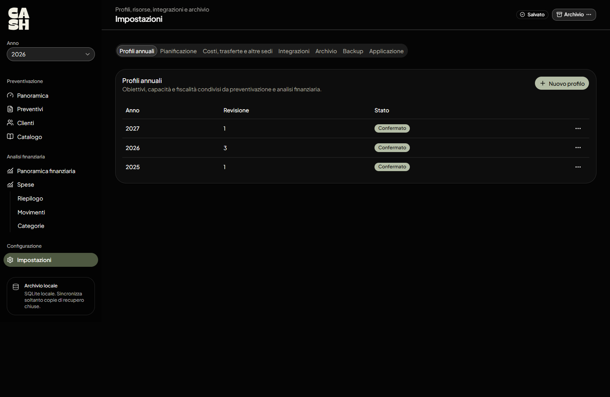
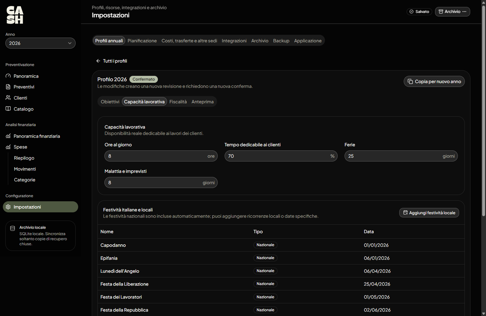
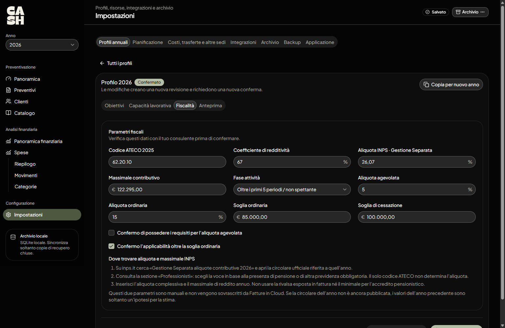
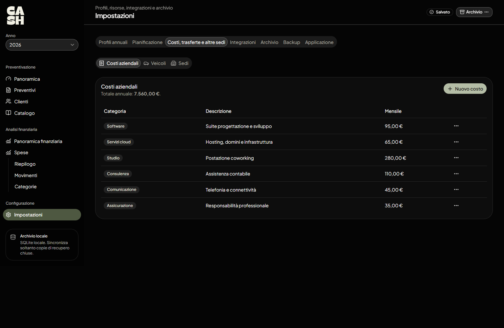
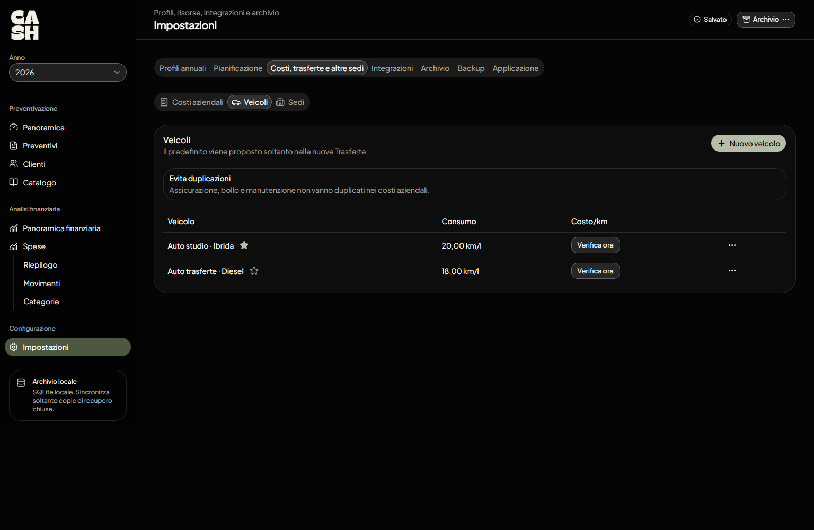
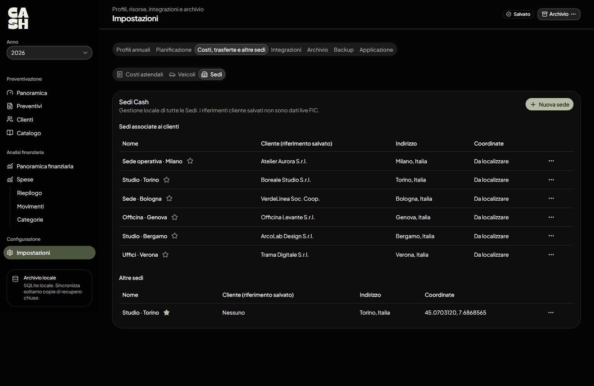
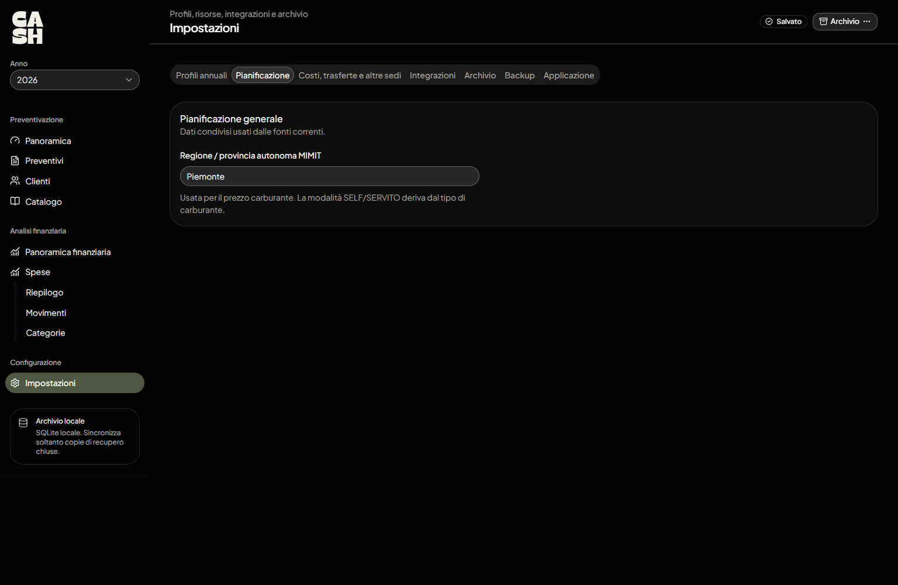
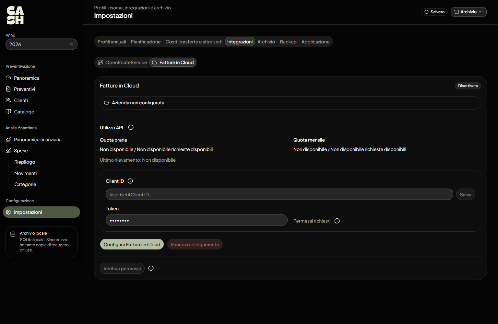
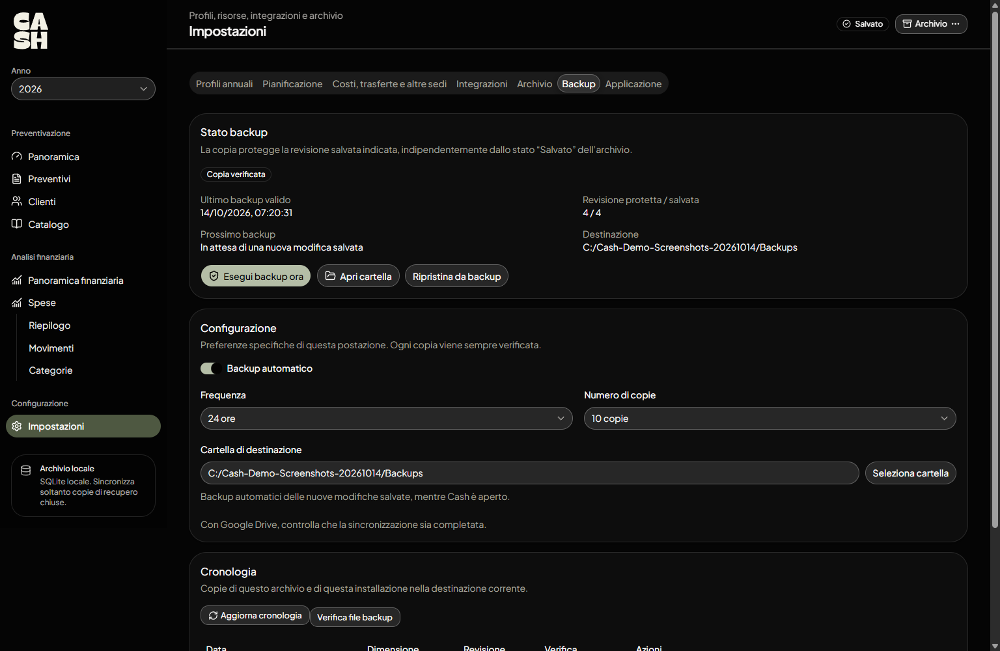
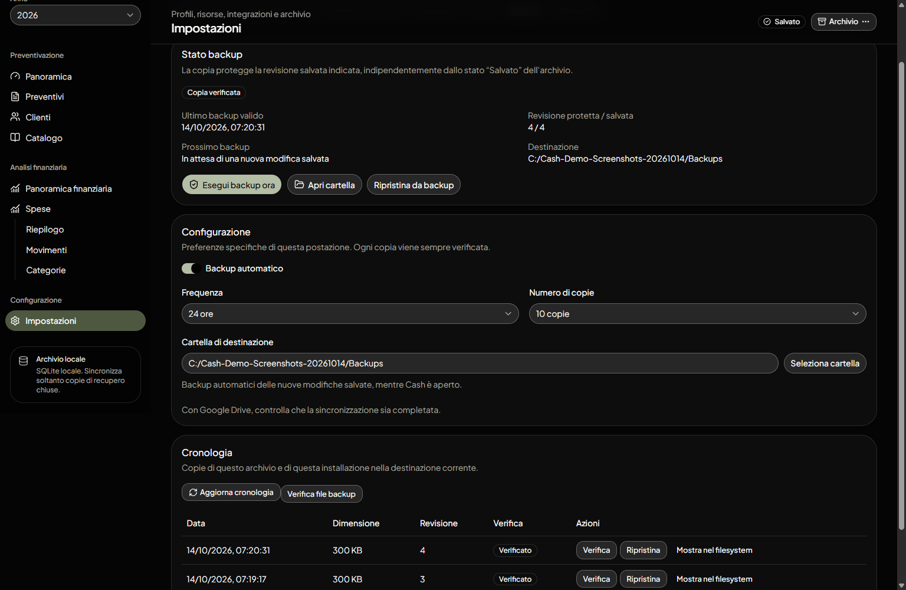

# Configurazione iniziale

Questa guida prepara Cash per calcolare preventivi e leggere i costi dell'attività. **Fatture in Cloud e OpenRouteService sono facoltativi**: puoi iniziare da profili, costi e preventivi locali.

## 1. Archivio e anno

Crea o apri un archivio `.sqlite` su disco locale come indicato nella [guida all'installazione](installazione.md). In alto a sinistra trovi il selettore **Anno**, usato per consultare i dati e le analisi relativi all'anno scelto.

Non collocare il database attivo in una cartella sincronizzata: per Google Drive o servizi simili configura il backup in seguito.

## 2. Profilo annuale

Apri **Impostazioni → Profili annuali** e scegli **Nuovo profilo**, oppure aprine uno esistente. I profili permettono di stimare quanto devi fatturare e quante ore puoi dedicare ai clienti.

All'interno di un profilo sono presenti quattro sezioni:

- **Obiettivi:** fatturato da raggiungere e spese specifiche annue previste.
- **Capacità lavorativa:** ore giornaliere, percentuale di tempo dedicabile ai clienti, ferie, imprevisti e festività.
- **Fiscalità:** regime e parametri per le proiezioni, come redditività e contributi INPS.
- **Anteprima:** riepilogo della stima economica e del valore orario obiettivo.

**Conferma il profilo** dopo aver verificato i parametri: le proiezioni richiedono un profilo confermato e calcolabile. Una modifica genera una nuova revisione da verificare. Puoi copiare un profilo per preparare un altro anno, ma controlla nuovamente i valori, soprattutto quelli fiscali.

I risultati fiscali sono **stime**, non un sostituto del prospetto del commercialista. Anche i parametri precompilati vanno verificati per l'anno di riferimento.

## 3. Costi, veicoli e sedi

Apri **Impostazioni → Costi, trasferte e altre sedi**.

### Costi aziendali

Nella scheda **Costi aziendali**, inserisci i costi ricorrenti necessari alla tua attività: software, servizi cloud, studio, telefonia e altre voci pertinenti. L'interfaccia mostra gli importi mensili e il relativo totale annuale.

### Veicoli

Nella scheda **Veicoli**, aggiungi i mezzi utilizzati nelle trasferte e configura i parametri effettivamente richiesti dalla scheda, tra cui alimentazione, consumo, percorrenza e costi del veicolo.

Puoi indicare un veicolo predefinito per le nuove trasferte. **Evita di duplicare** assicurazione, bollo e manutenzione nei costi aziendali se li stai già considerando nei costi del veicolo.

### Sedi

Nella scheda **Sedi**, registra i luoghi di partenza e le destinazioni ricorrenti. Le sedi possono essere associate ai riferimenti cliente; sono informazioni salvate in Cash, non modifiche in tempo reale all'anagrafica Fatture in Cloud.

Per calcolare una rotta tramite OpenRouteService servono coordinate valide per partenza e destinazione. Se necessario, puoi comunque inserire manualmente distanza e durata della trasferta.

## 4. Pianificazione e carburante

In **Impostazioni → Pianificazione** inserisci il territorio di riferimento MIMIT per il prezzo del carburante. Il tipo di carburante del veicolo determina la modalità prevista per il dato utilizzato.

Il prezzo e il costo di una trasferta dipendono dai parametri disponibili: verifica i dati del mezzo e l'eventuale risultato prima di usarlo in un preventivo.

## 5. Integrazioni facoltative

Le integrazioni si trovano in **Impostazioni → Integrazioni**.

### Fatture in Cloud

Per collegare Fatture in Cloud:

1. Apri la scheda **Fatture in Cloud** e avvia la configurazione.
2. Inserisci il **Client ID** richiesto dalla procedura.
3. Genera e inserisci un **token manuale** con i permessi indicati nell'interfaccia.
4. Verifica il token e scegli l'azienda da collegare.
5. Seleziona il prodotto Fatture in Cloud con nome esatto **Consulenza**, richiesto dalla procedura, e conferma l'attivazione.

Il Client ID e il token della postazione non sono dati da inserire nelle guide o condividere. Il token viene memorizzato localmente nella postazione; per altre postazioni la configurazione può dover essere ripetuta.

Con il collegamento attivo, Cash può consultare i clienti dell'azienda, aggiornare i dati amministrativi per l'analisi e inviare un preventivo tramite l'azione **Esporta FIC**. L'aggiornamento della panoramica finanziaria è un'azione esplicita, non una sincronizzazione continua.

La configurazione può rendere disponibili alcuni dati fiscali dell'azienda. Verifica comunque le impostazioni annuali e i valori INPS.

### OpenRouteService

Nella scheda **OpenRouteService**:

1. Inserisci la tua **API key**.
2. Seleziona **Verifica connessione**.
3. Verifica l'esito prima di calcolare percorsi nei preventivi.

La chiave viene conservata solo su questa postazione. In una trasferta puoi chiedere il calcolo di distanza e tempo da due sedi con coordinate oppure utilizzare valori manuali.

## 6. Backup

Apri **Impostazioni → Backup** e configura la protezione dell'archivio.

1. Scegli la **cartella di destinazione**.
2. Abilita **Backup automatico** se vuoi copie periodiche.
3. Seleziona **Frequenza** e **Numero di copie** da conservare.
4. Esegui **Backup ora** e controlla che il risultato sia verificato.
5. Usa **Cronologia** per verificare le copie o ripristinarne una.

Le copie vengono verificate e quelle precedenti vengono conservate secondo il numero impostato. I backup automatici delle nuove revisioni salvate funzionano **mentre Cash è aperto**: non sostituiscono un servizio di backup del computer sempre attivo.

**Google Drive:** puoi scegliere una cartella locale sincronizzata dal client Google Drive come destinazione dei backup. Non è un collegamento API diretto a Drive. Controlla che i file siano stati effettivamente sincronizzati prima di considerare sicura anche la copia remota. Non sincronizzare il database SQLite attivo.

Se la destinazione non è più disponibile, consulta lo stato del backup e seleziona o ricrea la cartella prima di riprovare. Il ripristino modifica l'archivio utilizzato: scegli con attenzione la copia.

## 7. Verifica finale

Prima di iniziare un preventivo controlla di avere:

- un profilo annuale **confermato**, con obiettivi e capacità realistici;
- costi aziendali inseriti senza duplicazioni;
- veicoli e sedi, se prevedi trasferte;
- un backup verificato.

Le integrazioni possono essere attivate anche successivamente. Prosegui con la [guida all'utilizzo](utilizzo.md).
