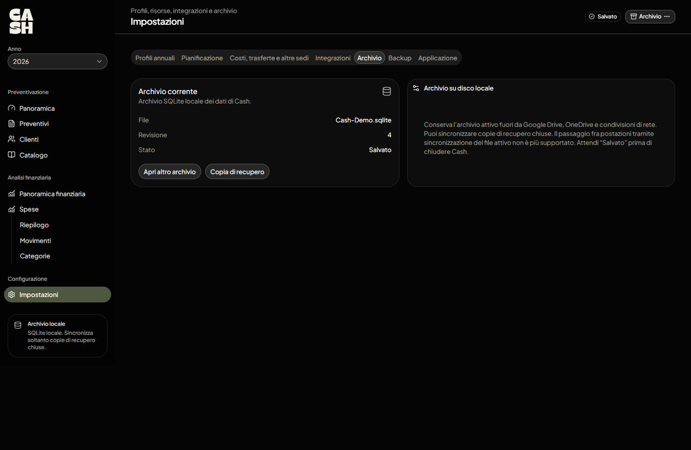

# Installazione e primo avvio

Cash è un'applicazione desktop per **Windows x64**. L'archivio dei dati è un file SQLite locale: non devi installare un database separato né avviare un server.

## Installare una versione pubblicata

Apri la pagina [Releases di Cash](https://github.com/Capobuf/Cash/releases) e scarica il file desiderato:

| File | Utilizzo |
| --- | --- |
| `Cash-Setup-<versione>.exe` | Installa Cash sul PC |
| `Cash.exe` | Avvia la versione portabile, senza installazione |

I due pacchetti sono prodotti dalla pipeline Windows del repository. La versione installata supporta la verifica degli aggiornamenti dall'app; per la versione portabile utilizza la pagina Releases.

## Primo avvio: creare l'archivio

Al primo avvio Cash mostra le azioni per creare, aprire o ripristinare un archivio.

1. Seleziona **Crea archivio**.
2. Scegli una posizione su **disco locale** e assegna un nome al file `.sqlite`.
3. Apri **Impostazioni → Profili annuali** per impostare il primo anno di lavoro.
4. Prosegui con la [configurazione iniziale](configurazione-iniziale.md).

Se possiedi già un archivio Cash, usa **Apri archivio**. Dalla stessa funzione è possibile avviare l'importazione di un precedente archivio JSON, quando supportato dal file selezionato.

**Importante:** l'archivio SQLite *attivo* deve rimanere su un disco locale, fuori dalle cartelle sincronizzate con Google Drive/OneDrive e dalle condivisioni di rete. Per la sincronizzazione esterna si usano le **copie di backup**, non il database aperto.



Il pulsante **Archivio** in alto a destra consente di aprire un altro archivio, salvare e creare una copia di recupero. Lo stato **Salvato** indica che le modifiche all'archivio sono state registrate; non equivale alla presenza di un backup aggiornato.

## Avviare Cash dal codice sorgente

Per lo sviluppo servono **Windows, Git, Node.js 24 e npm**. Node.js 24 è anche la versione utilizzata dalla CI.

```powershell
git clone https://github.com/Capobuf/Cash.git
cd Cash
npm ci
npm run dev
```

Comandi disponibili:

| Comando | Scopo |
| --- | --- |
| `npm run dev` | Compila la versione di sviluppo e apre Electron |
| `npm run build` | Compila l'applicazione |
| `npm run package:win` | Genera installer e versione portabile nella cartella `release/` |
| `npm run typecheck` | Verifica i tipi TypeScript |
| `npm run lint` | Verifica le regole ESLint |
| `npm test` | Esegue i test Vitest |

La CI esegue anche controlli di formattazione e test SQLite sulla versione Electron, installata e portabile. I comandi sopra sono ricavati dagli script presenti nel repository.

## Aggiornamenti e recupero

- **Versione installata:** controlla **Impostazioni → Applicazione** per le funzioni di aggiornamento disponibili.
- **Versione portabile o di sviluppo:** consulta le [Releases](https://github.com/Capobuf/Cash/releases) e scarica manualmente la versione appropriata.
- **Recupero dati:** usa **Impostazioni → Backup → Ripristina da backup**, oppure l'azione di ripristino disponibile prima di aprire un archivio. Verifica sempre l'archivio interessato prima di procedere.

Per preparare profili, veicoli, sedi, servizi esterni e copie di sicurezza, continua con la [guida alla configurazione](configurazione-iniziale.md).
