# Guida all'utilizzo

Cash unisce la **preventivazione interna** alla lettura dei costi dell'attività. Questa guida segue le voci della navigazione laterale. Per preparare il primo archivio, consulta prima la [configurazione iniziale](configurazione-iniziale.md).

> Tutte le immagini usano dati dimostrativi, non clienti, conti o fatture reali.

## Panoramica

La pagina **Panoramica** riassume il contesto economico dell'anno selezionato: valore orario obiettivo, fatturato obiettivo, stima del netto fiscale, capacità lavorativa e preventivi recenti.

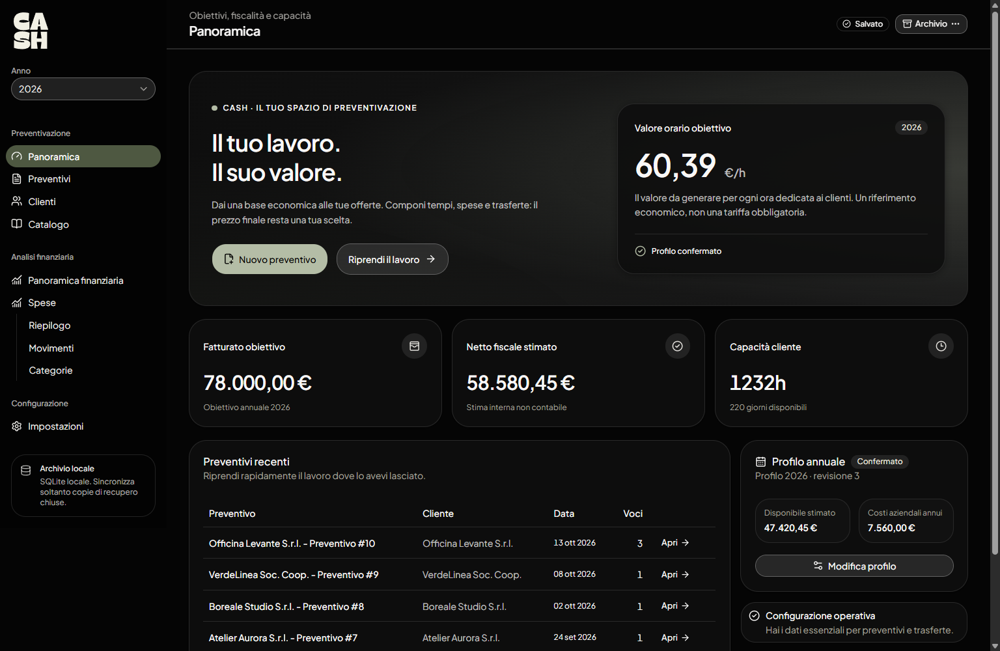

Il valore orario è un **riferimento derivato dal profilo annuale**, non una tariffa imposta dall'app. Se non è disponibile, verifica di aver configurato e confermato il profilo in **Impostazioni → Profili annuali**.

Usa il selettore **Anno** nella barra laterale per passare al periodo che vuoi consultare.

## Preventivi

### Creare e compilare

1. Apri **Preventivi** e seleziona **Nuovo preventivo**.
2. Imposta data e profilo annuale; associa il cliente e la sede principale quando disponibili.
3. In **Lavoro da eseguire**, scrivi il nome della prossima attività e premi **Invio** o **Aggiungi riga**. Puoi lasciare durata e spesa vuote e quantificarle in seguito. Sono disponibili anche **Trasferta**, **Spesa**, **Riga generica** e **Da template**.
4. Modifica nome, durata e importo direttamente nelle celle. Espandi una voce per consultarne le sottovoci e scegliere le varianti; le trasferte mantengono il dialogo con percorso e parametri.
5. Inserisci il **Prezzo scelto** nella riga: l'**Analisi economica**, accanto o sotto la tabella secondo la larghezza della finestra, aggiorna subito il totale durante un input valido.

Il pulsante **+** di una riga permette di inserire il lavoro successivo in quel punto. La ricerca dei template considera anche nomi delle voci, descrizioni delle attività e opzioni di variante.

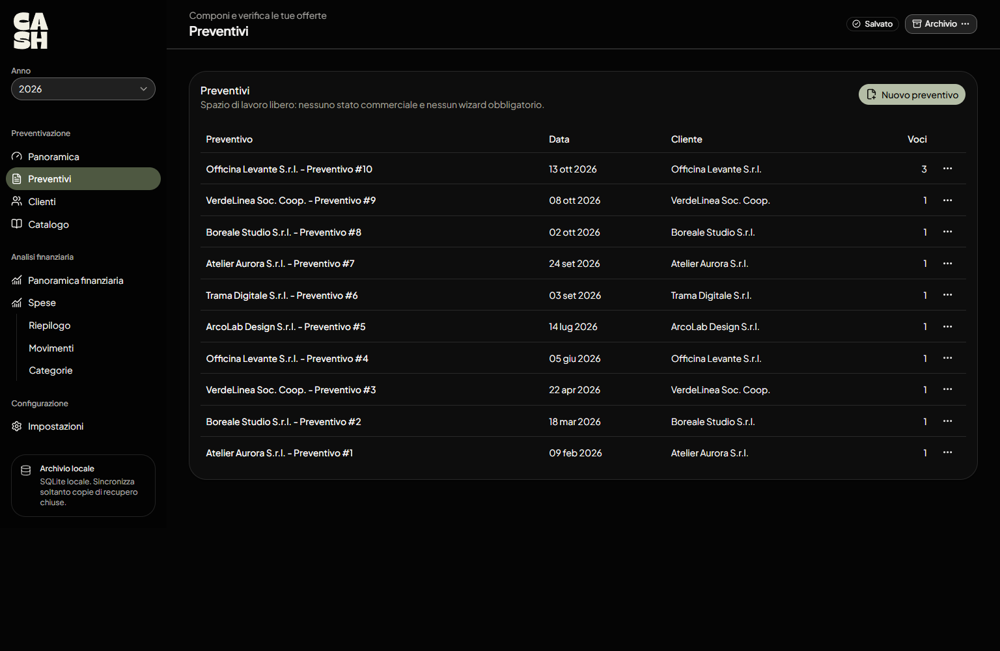

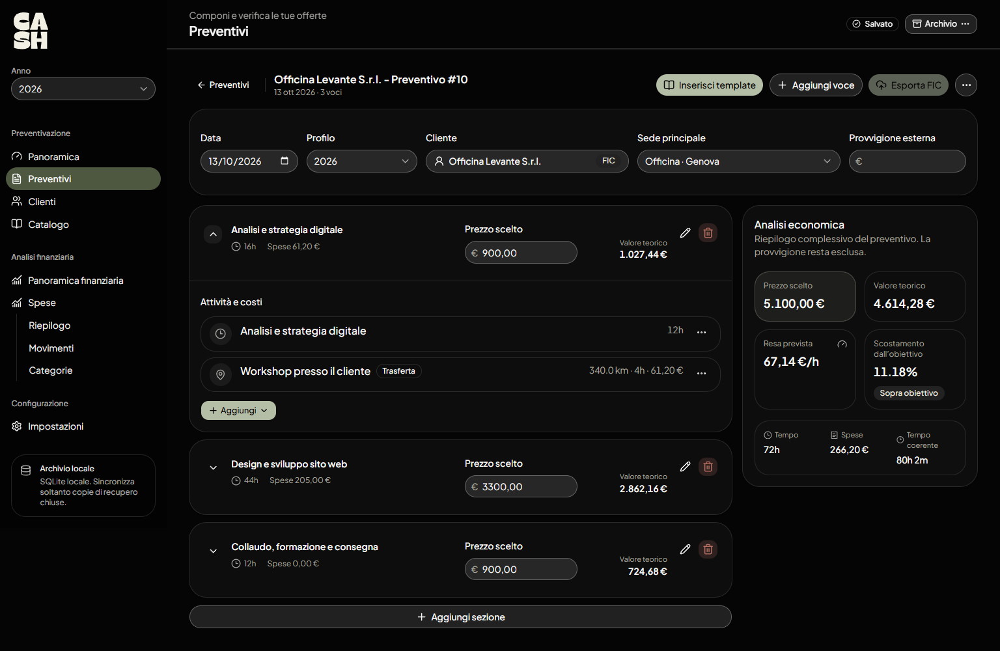

L'analisi distingue tra:

- **Valore teorico:** riferimento calcolato dai tempi, dai costi e dai parametri disponibili.
- **Prezzo scelto:** importo che decidi di attribuire alle voci del preventivo.
- **Resa prevista e scostamento:** indicatori per confrontare la decisione con l'obiettivo orario.
- **Tempo e spese:** grandezze complessive considerate nell'analisi.

Non è obbligatorio completare tutte le sottovoci per assegnare un prezzo scelto; il riferimento teorico dipende invece dai dati effettivamente disponibili. I preventivi sono uno spazio di lavoro interno, senza un flusso commerciale obbligatorio.

### Rinominare un preventivo

Il titolo predefinito è **Cliente - Preventivo #N**, oppure **Preventivo #N** se manca il cliente. Usa il pulsante con la matita **Rinomina preventivo** accanto al titolo per inserire un nome personalizzato: lo stesso nome compare nell'elenco, nel dettaglio e nella Panoramica e rimane anche cambiando cliente.

Nel dialogo, **Ripristina titolo automatico** torna al nome basato su cliente e numero correnti. Anche salvare il campo vuoto ripristina il titolo automatico. La rinomina non cambia il numero progressivo, le voci, i prezzi o le descrizioni esportate in Fatture in Cloud.

### Organizzare le voci in contenitori

Con **Nuovo contenitore** scegli il nome e crea il gruppo in un solo passaggio. Usa **Aggiungi → Aggiungi riga** oppure **Aggiungi → Da template** per inserirvi il lavoro. I contenitori sono facoltativi, servono solo a organizzare le voci e non cambiano prezzi o totali.

Usa la maniglia per spostare una voce dentro un contenitore, fra le sue voci, in un altro contenitore o fuori. Puoi anche riordinare i contenitori insieme alle voci indipendenti. Da tastiera, porta il focus sulla maniglia e premi **Spazio**, usa le **frecce** e conferma con **Spazio**; **Esc** annulla lo spostamento.

Eliminando un contenitore, le sue voci restano nel preventivo nello stesso ordine e nella stessa posizione relativa. L'export segue l'ordine visibile; i contenitori non creano righe Fatture in Cloud e non attivano automaticamente il raggruppamento delle righe esportate.

### Calcolare una trasferta

Aggiungi una sottovoce di tipo **Trasferta** e compila partenza, destinazione, veicolo, occorrenze e indicazione **Andata e ritorno**.

Nei selettori delle trasferte, nome, indirizzo disponibile e cliente associato distinguono le sedi omonime. La **Sede principale** separa le sedi del cliente selezionato dalle altre sedi senza cliente; resta disponibile la creazione contestuale di una sede con il pulsante **+**.

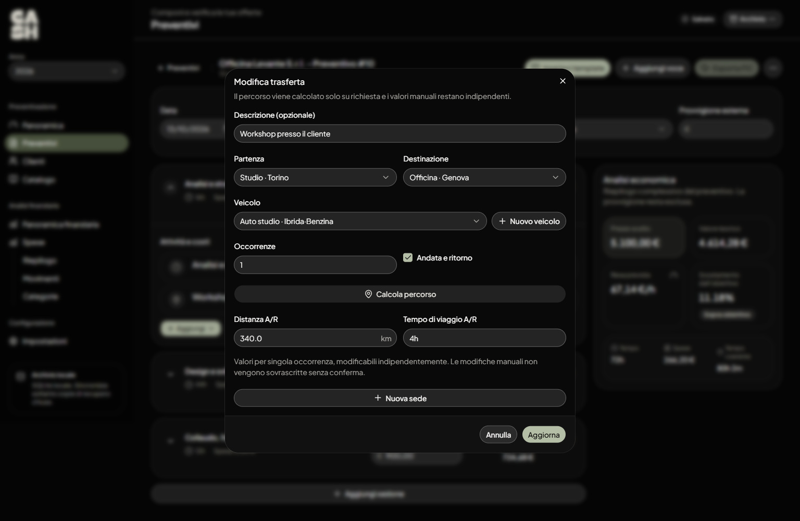

Con OpenRouteService configurato e coordinate valide, **Calcola percorso** propone distanza e tempo. I valori possono essere inseriti anche manualmente e non vengono sovrascritti senza le conferme previste dalla schermata. Puoi rappresentare spostamenti distinti creando più trasferte, ad esempio una visita e un successivo viaggio per recuperare materiale.

### Esportare verso Fatture in Cloud

Con l'integrazione attiva, usa **Esporta FIC** dal preventivo e segui la procedura per selezionare il cliente e controllare le righe da inviare. La funzione richiede la configurazione descritta nella [guida alle integrazioni](configurazione-iniziale.md#5-integrazioni-facoltative).

L'esportazione non trasforma automaticamente ogni sottovoce o spesa interna in una riga autonoma. Controlla il riepilogo prima dell'invio e verifica su Fatture in Cloud l'esito di eventuali tentativi incerti.

## Catalogo

Il **Catalogo** evita di ricostruire ogni volta le stesse attività.

- **Template:** gruppi di voci di lavoro riutilizzabili; puoi cercarli, crearli e inserirli in un preventivo.
- **Elementi singoli:** attività, spese e trasferte da riprendere nei preventivi.

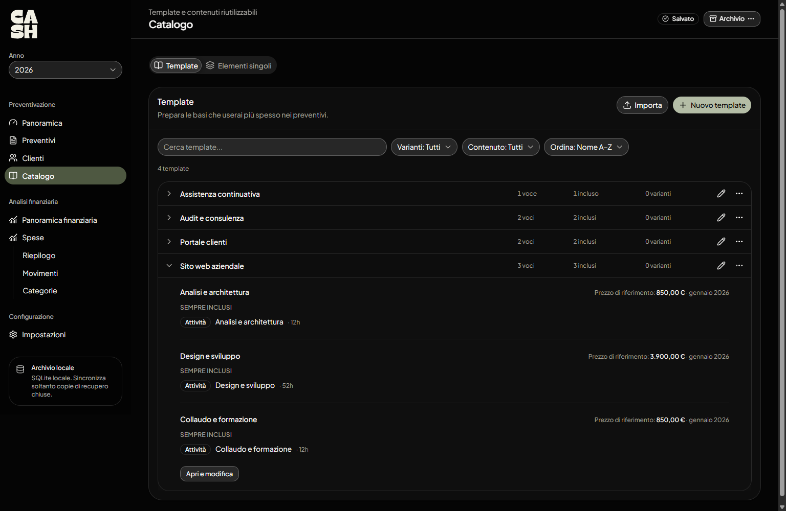

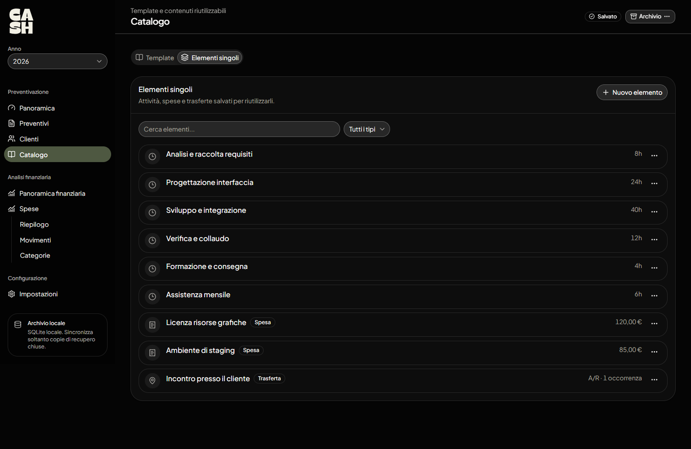

È disponibile anche l'importazione dei template nel formato JSON previsto dall'applicazione. Non confonderla con l'importazione dei movimenti bancari, che utilizza XLSX e CSV.

## Clienti

La pagina **Clienti** visualizza l'anagrafica ottenuta dall'azienda **Fatture in Cloud collegata**. Quando la connessione è attiva puoi consultare i clienti e gestire i riferimenti di sede conservati in Cash.

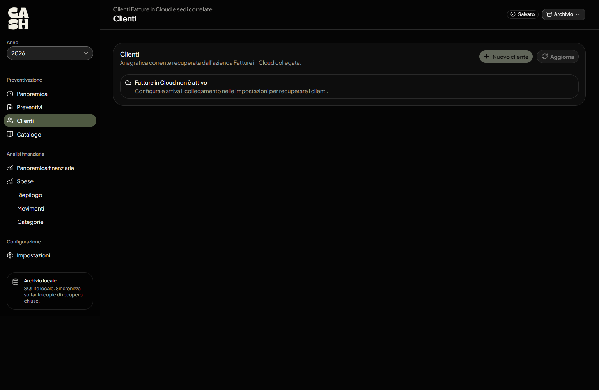

L'immagine mostra intenzionalmente lo **stato senza integrazione**: la pagina non offre una rubrica locale alternativa completa. I riferimenti cliente presenti nei preventivi e le sedi già salvate non equivalgono a un'anagrafica live aggiornata.

## Panoramica finanziaria

Questa pagina combina il profilo economico con i dati amministrativi acquisiti da Fatture in Cloud e le uscite registrate in Cash.

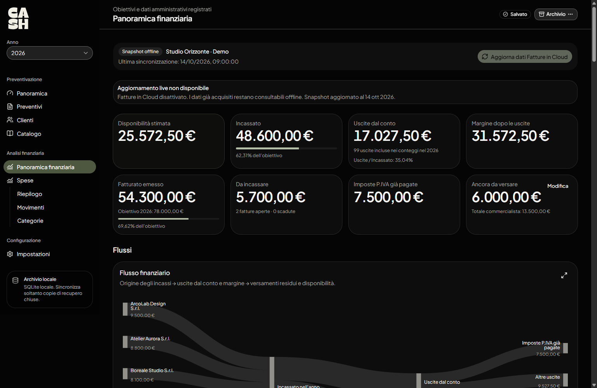

Gli indicatori comprendono, quando i dati sono disponibili, fatturato emesso, incassato, importi da incassare, uscite e disponibilità stimata. Le visualizzazioni permettono di esaminare flussi, andamento mensile e distribuzione dei clienti.

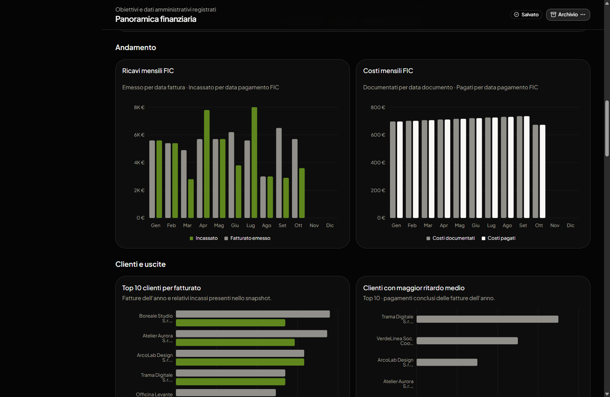

**Come aggiornare i dati:** configura Fatture in Cloud in **Impostazioni → Integrazioni**, poi usa **Aggiorna dati Fatture in Cloud**. Non si tratta di una sincronizzazione continua. Se il collegamento non è disponibile, rimane consultabile l'ultimo snapshot acquisito, con indicazione della sua data.

Per alcune stime fiscali puoi inserire il totale annuale indicato dal commercialista attraverso **Modifica** nella relativa card. Usa questa correzione solo se conosci il dato di riferimento; la [schermata di dettaglio](images/screenshots/financial-tax-total-dialog.webp) spiega quali importi includere ed escludere per evitare doppi conteggi.

Le stime mostrate non sostituiscono il rendiconto contabile né il parere del consulente fiscale.

## Spese

La sezione **Spese** comprende **Riepilogo**, **Movimenti** e **Categorie**.

### Importare i movimenti

Apri **Spese → Movimenti** e seleziona **Importa XLSX / CSV**.

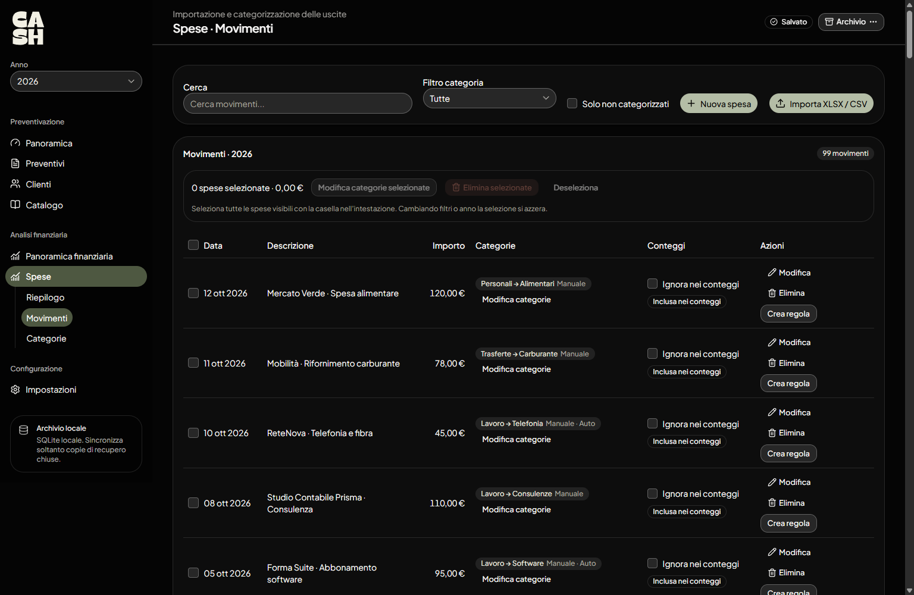

L'importazione è pensata per specifici tracciati bancari:

- **XLSX Fineco:** richiede le colonne del tracciato supportato, tra cui `Data_Valuta`, `Entrate`, `Uscite` e `Descrizione`.
- **CSV Revolut:** richiede l'intestazione del tracciato supportato e gestisce le uscite in **EUR**.

Non tutti i file Excel o CSV generici sono compatibili. Se la struttura è diversa, l'app segnala le colonne richieste. Vengono considerate le **uscite**; le entrate sono ignorate. I movimenti già importati vengono riconosciuti come duplicati, e al termine è mostrato il riepilogo dell'operazione.

I movimenti importati sono disponibili nei rispettivi anni senza dover ripetere l'importazione cambiando il selettore **Anno**.

### Correggere una spesa

Dalla pagina **Movimenti** puoi cercare, filtrare, creare una spesa manuale, modificarla e gestire le categorie associate. È possibile selezionare più movimenti per operazioni di categorizzazione.

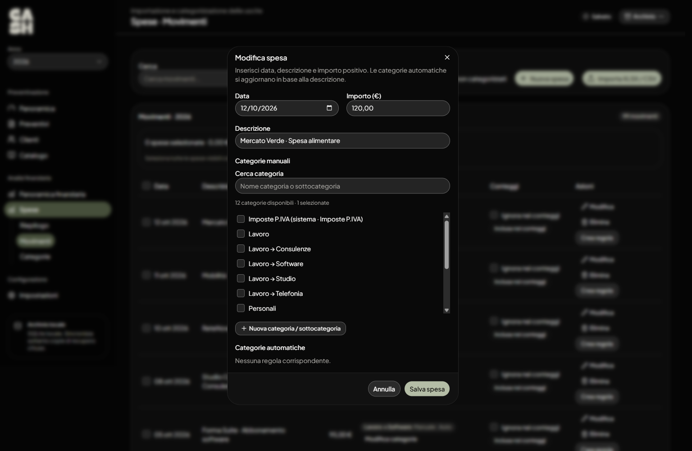

Il comando **Ignora nei conteggi** esclude un movimento dalle analisi senza richiedere di eliminarlo dall'archivio. È utile, per esempio, per movimenti che non vuoi includere nei totali economici.

### Categorie e regole automatiche

In **Spese → Categorie** puoi creare categorie, sottocategorie e **regole automatiche** basate sul testo delle descrizioni bancarie.

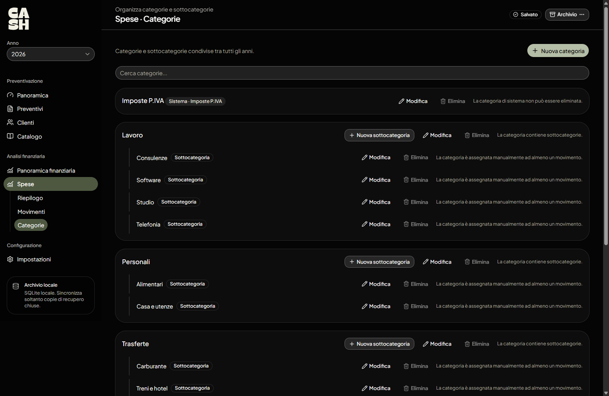

Dopo aver assegnato manualmente una spesa, puoi utilizzare **Crea regola** per riconoscere movimenti con descrizioni simili. Le regole valgono per le spese presenti e future di tutti gli anni; modificarle aggiorna le assegnazioni automatiche.

Puoi anche **ignorare una categoria nei conteggi**, escludendo le spese interessate. Una spesa assegnata a più categorie non viene sommata più volte nel totale generale.

### Riepilogo delle uscite

Apri **Spese → Riepilogo** per controllare il totale delle spese incluse, quante sono categorizzate e come si distribuiscono fra categorie e sottocategorie. Il grafico a flussi aiuta a individuare rapidamente le aree di costo più significative.

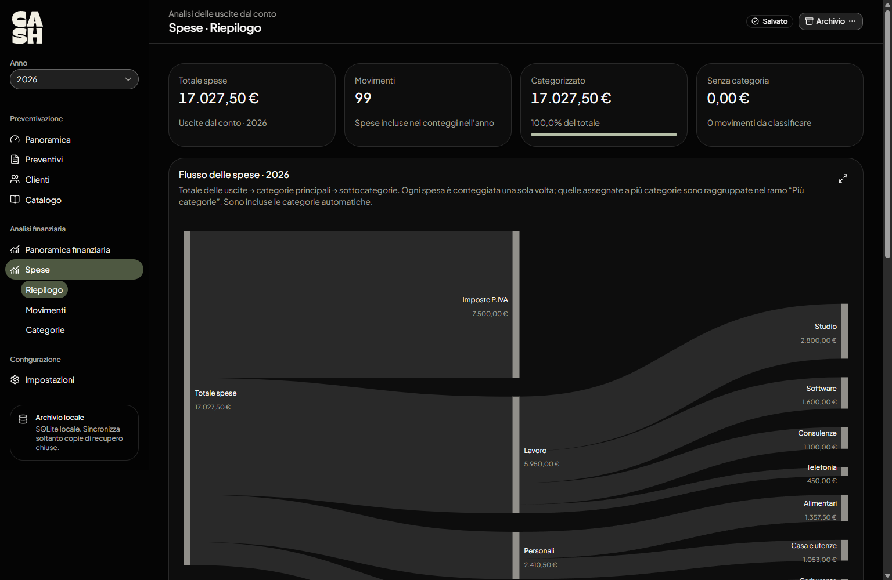

## Archivio, backup e aggiornamenti

- Controlla lo stato **Salvato** prima di chiudere l'app o cambiare archivio.
- Apri **Impostazioni → Archivio** per vedere il file corrente o creare una copia di recupero.
- In **Impostazioni → Backup** puoi eseguire, verificare e ripristinare copie di sicurezza.
- In **Impostazioni → Applicazione** trovi le informazioni sulla versione e sugli aggiornamenti disponibili per la modalità di esecuzione.

Per i dettagli sulla protezione dei file e su Google Drive, vedi [Configurazione iniziale → Backup](configurazione-iniziale.md#6-backup).

## Un flusso pratico

Per un nuovo incarico: controlla il profilo dell'anno, crea il preventivo, aggiungi le attività previste, calcola le trasferte e valuta **quanto chiedere rispetto a quanto spenderai**. Dopo aver svolto il lavoro, consulta periodicamente i movimenti bancari e, se lo utilizzi, aggiorna lo snapshot Fatture in Cloud per capire come stanno andando incassi e costi.

Cash serve soprattutto a questo: **rendere esplicite decisioni economiche che altrimenti resterebbero soltanto nella testa di chi lavora**.
